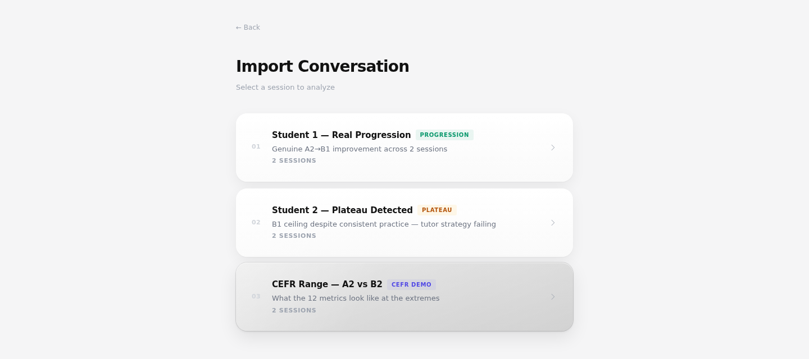

# Language Coach

Post-lesson analytics for language tutors: feed it the Deepgram transcripts of a student's lessons and it shows how the student is actually progressing (vocabulary, talk time, errors, confidence, CEFR estimate).


Built for the Preply Hackathon 2026. Vercel project: https://preplyfinal.vercel.app (frontend only; the analysis API needs the API keys below).

## What it is

Preply gave us Deepgram transcripts of real lessons for two students. The idea was to turn that raw data into something a tutor can read in two minutes after a class, instead of relying on gut feeling about whether the student is improving. The app has two preset stories: Student 1, who improves across sessions, and Student 2, who has plateaued. Each one runs the full pipeline and renders twelve metrics with explanations.

## How it works

- `run.py` reads a lesson folder of Deepgram JSON (per-word timestamps, speaker diarization, sentiment, topics) and computes the countable metrics: talk ratio, new words versus the previous session, active recall, filler pressure by topic, conversational agency, sentiment arc, topic expansion.
- The same transcript then goes to Claude for the things you cannot count: top errors with a fix, self-repairs, code-switching, grammar "gray zones" the student avoids, a CEFR estimate with reasoning and a short session summary.
- `_api.py` is a FastAPI app that exposes the presets, runs the pipeline on demand and caches each result as JSON. With `DATABASE_URL` set it also stores sessions in PostgreSQL (`db.py`).
- `api/index.py` and `main.py` wrap the API so Vercel can run it as a serverless function under `/api`.
- `frontend/` is a Vite + React app: the landing page above, then the metric cards built with ECharts, Framer Motion and a gauge component.



The import screen with the presets. Picking one runs the pipeline (about 20 s) and opens the dashboard. Audio input exists but is not wired end to end (`scripts/record.py`, `scripts/transcribe_rich.py`, placeholder `/live/*` endpoints).

## Stack

Python 3.10+, FastAPI, Deepgram SDK, Anthropic SDK, psycopg2. Frontend: Vite, React 19, TypeScript, Tailwind CSS v4, Framer Motion, ECharts. Deployed on Vercel.

## Run it

Backend (needs `DEEPGRAM_API_KEY` and `ANTHROPIC_API_KEY`; `DATABASE_URL` is optional):

```bash
pip install -r requirements.txt
DEEPGRAM_API_KEY=... ANTHROPIC_API_KEY=... uvicorn _api:app --reload --port 8000
```

Frontend (the dev server proxies `/api` to port 8000):

```bash
cd frontend
npm install --legacy-peer-deps
npm run dev
```

Pipeline only: `python run.py preply "Student-1/lesson-1" "Student-1/lesson-3"`

## Team

- Luis Molina Salvador ([34lumo](https://github.com/34lumo))
- Mateo Perez ([mpchachi](https://github.com/mpchachi))
